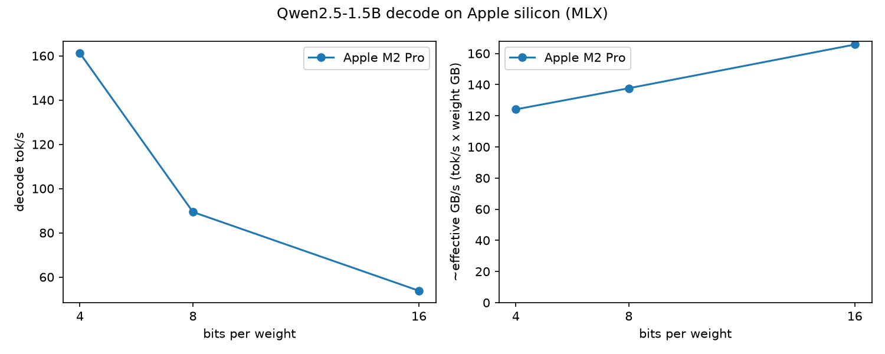

# Apple Silicon Decode Efficiency

<!-- TODO: one-line question -->

## Result

<!-- TODO: one-line result + table -->

## Method

<!-- TODO -->

## Reproduce

<!-- TODO -->

## Limitations

<!-- TODO -->

## Next: IPW profiling

<!-- TODO -->
